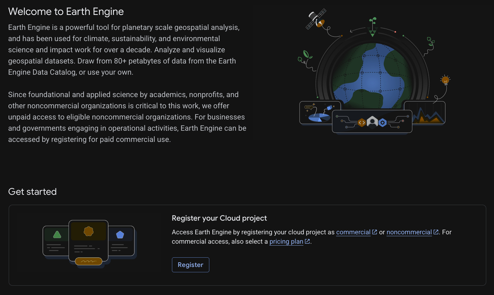

# Pre-Workshop Setup

If you do not already have a GEE account, you will need to create one.

## GEE Account

Create a <a href="https://code.earthengine.google.com/register" target="_blank" rel="noopener noreferrer">Google Earth Engine account</a> (https://code.earthengine.google.com/register). 

You will need a <a href="https://accounts.google.com/signup" target="_blank" rel="noopener noreferrer">Google account</a> (https://accounts.google.com/signup). 

Create a GEE account for non-commercial purposes.

Follow the steps below if you want to register your own GEE cloud project:

## GEE Cloud Project

Text adapted from: [GEE Developers Quick Start Guide](https://developers.google.com/earth-engine/guides/quickstart_javascript). See this resource for the most updated information on cloud project creation.

**Register or create a Google Cloud Project [here](https://console.cloud.google.com/earth-engine).**
You'll be prompted to complete the following steps. If you already have a project registered for Earth Engine access, you can choose to use that one (but be aware if it is a noncommercial or commercial cloud project).

- Select the project's purpose: commercial or noncommercial.
- If the purpose is noncommercial, select a project type. (Trainings are noncommercial.)
- Create a new Google Cloud project (giving it a name, which cannot be changed later).
- Confirm your project information.

